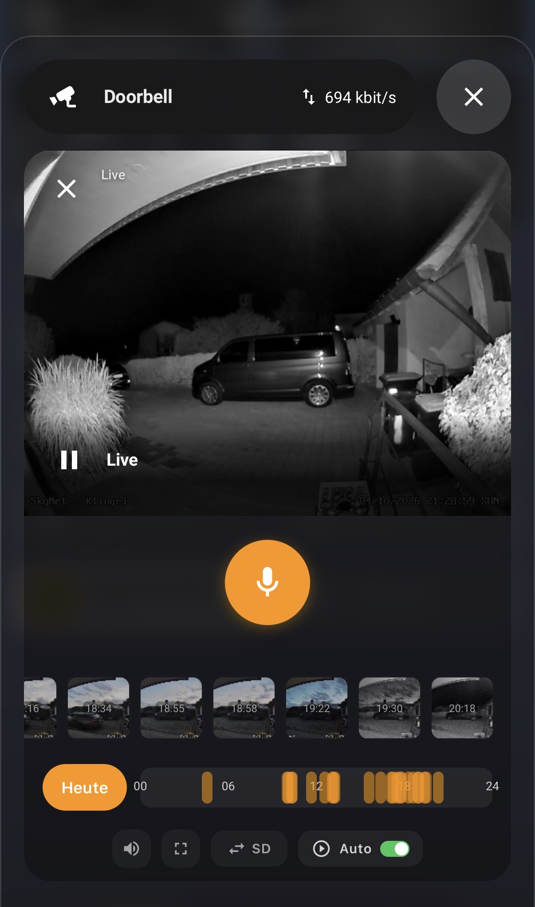
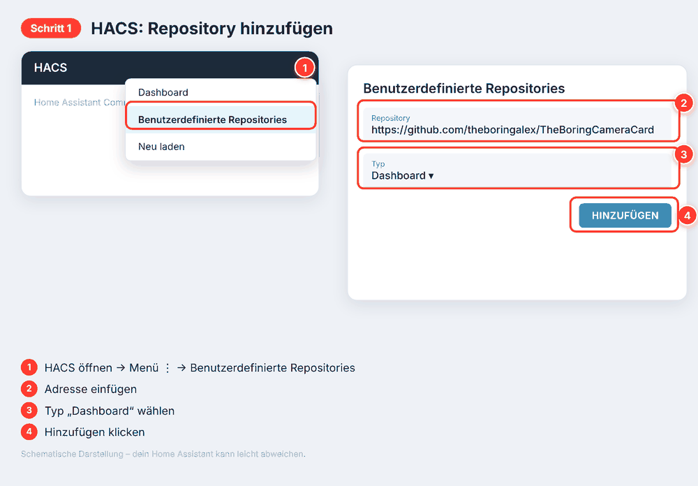
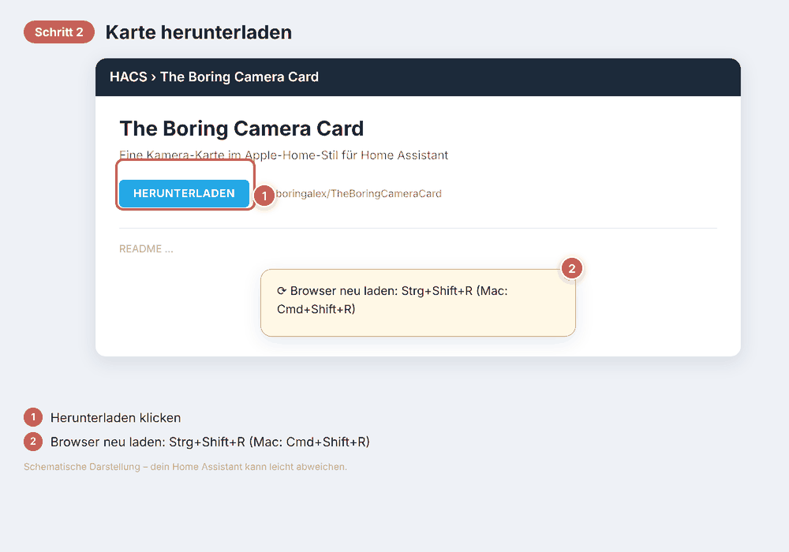
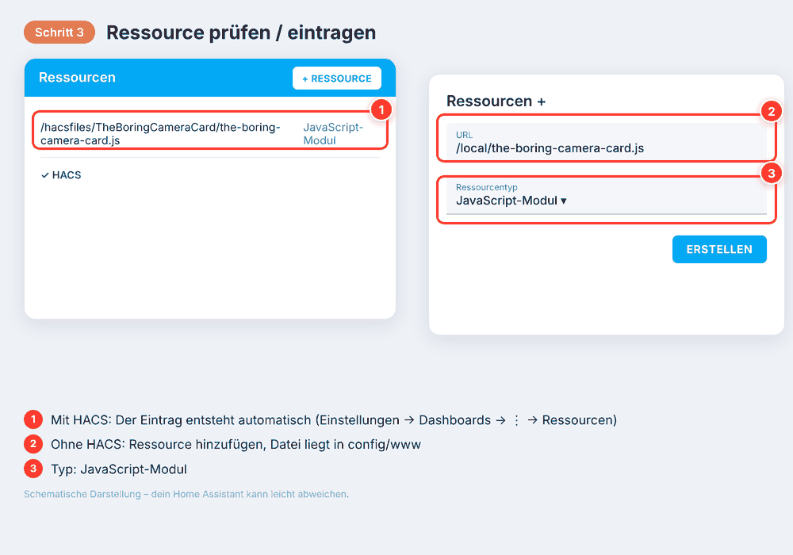
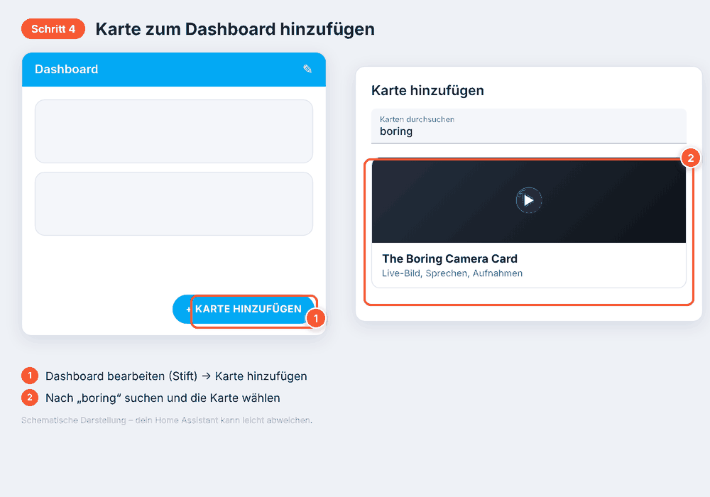
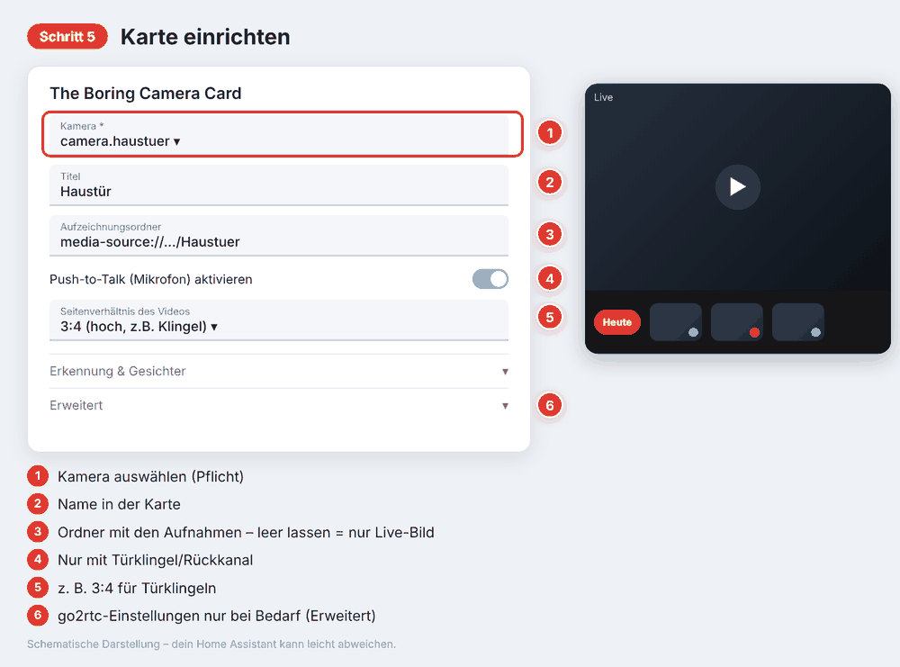

# The Boring Camera Card

*[English version](README.md)*

[](https://my.home-assistant.io/redirect/hacs_repository/?owner=theboringalex&repository=TheBoringCameraCard&category=plugin)
[](https://www.buymeacoffee.com/theboringalex)

Eine Kamera-Karte für dein Home-Assistant-Dashboard, die aussieht und sich anfühlt wie die
Kameraansicht in Apple Home: flüssiges Live-Bild, ein Knopf zum Sprechen über den Lautsprecher
der Kamera und eine Leiste mit vergangenen Aufnahmen, durch die du scrollen und die du antippen
kannst.

<p align="center"></p>

## Download

| | |
|---|---|
| **HACS (empfohlen)** | [Repository zu HACS hinzufügen](https://my.home-assistant.io/redirect/hacs_repository/?owner=theboringalex&repository=TheBoringCameraCard&category=plugin) |
| **Manueller Download** | [the-boring-camera-card.js](https://github.com/theboringalex/TheBoringCameraCard/raw/main/the-boring-camera-card.js) · [Repository als ZIP](https://github.com/theboringalex/TheBoringCameraCard/archive/refs/heads/main.zip) |
| **Projekt unterstützen** | [Spendier mir einen Kaffee](https://www.buymeacoffee.com/theboringalex) |

## Was sie kann

- Live-Bild deiner Kamera über [go2rtc](https://github.com/AlexxIT/go2rtc), das Home Assistant schon mitbringt — schnell, zu Hause und unterwegs
- Push-to-Talk, wenn deine Kamera Ton wiedergeben kann (die meisten Video-Türklingeln können das)
- Eine Leiste mit Vorschaubildern vergangener Aufnahmen und festem „Heute"-Knopf; lang drücken zum Herunterladen oder Löschen
- Markierungen für Person / Tier / Fahrzeug an den Vorschaubildern (Reolink-KI-Erkennung) und runde Gesichts-Avatare (z. B. von [TheBoringFace](https://github.com/theboringalex/TheBoringFace))
- Ein Stream mit niedrigerer Qualität in der normalen Ansicht spart Daten, im Vollbild gibt es volle Qualität
- Auto-Livestream: startet von selbst, sobald die Karte sichtbar wird, und stoppt, wenn sie verschwindet
- Formate passend zur Kamera: 16:9, 4:3, 1:1 oder hoch 3:4 für Türklingeln

## Einrichtung

Kein YAML nötig — alles läuft über Formulare. *(Die Bilder sind schematisch; dein Home Assistant kann leicht abweichen.)*

### 1. Repository in HACS hinzufügen

HACS öffnen → Menü (⋮) → **Benutzerdefinierte Repositories**, `https://github.com/theboringalex/TheBoringCameraCard` einfügen, Typ **Dashboard** wählen, **Hinzufügen** klicken.



### 2. Karte herunterladen

*The Boring Camera Card* in HACS öffnen, **Herunterladen** klicken und den Browser neu laden (Strg+Shift+R, Mac: Cmd+Shift+R).



### 3. Dashboard-Ressource prüfen

HACS trägt sie normalerweise selbst ein. Wird die Karte später nicht gefunden, von Hand ergänzen: **Einstellungen → Dashboards → ⋮ → Ressourcen → Ressource hinzufügen**, URL `/hacsfiles/TheBoringCameraCard/the-boring-camera-card.js`, Typ **JavaScript-Modul**.



### 4. Karte zum Dashboard hinzufügen

Dashboard bearbeiten (Stift) → **Karte hinzufügen** → nach „boring" suchen → *The Boring Camera Card*.



### 5. Formular der Karte ausfüllen

Kamera auswählen, optional den Aufzeichnungsordner angeben und Push-to-Talk einschalten, wenn deine Kamera einen Lautsprecher hat. Der Rest ist optional.



### Von Hand (ohne HACS)

`the-boring-camera-card.js` nach `config/www/` kopieren, die Ressource `/local/the-boring-camera-card.js` (Typ *JavaScript-Modul*) wie in Schritt 3 eintragen und mit Schritt 4 weitermachen.

### Lieber YAML?

Alle Einstellungen lassen sich auch in YAML schreiben — siehe die **[YAML-Anleitung](docs/yaml-konfiguration.md)** mit Beispielen und allen Optionen.

```yaml
type: custom:the-boring-camera-card
entity: camera.haustuer
media_folder: media-source://media_source/local/Kamera/Haustuer
```

## Erweiterte Einstellungen

Der Abschnitt **Erweitert** der Karte enthält Optionen, die die meisten nie brauchen:

| Option | Wann du sie brauchst |
|---|---|
| `go2rtc_url` | Name des go2rtc-Streams, falls er vom Kamera-Entity abweicht |
| `go2rtc_url_sub` | Ein zweiter Stream mit niedrigerer Qualität für die normale Ansicht |
| `go2rtc_server_lan` | go2rtc läuft auf einem *anderen* Gerät als Home Assistant, z. B. `http://192.168.1.50:1984` |
| `go2rtc_ingress` | Fernzugriff über den eingebauten Proxy von Home Assistant (go2rtc-Add-on) |
| `go2rtc_server` | Eine eigene Web-Adresse für go2rtc, wenn du nicht zu Hause bist |
| `go2rtc_token` | Dein eigener Reverse-Proxy vor go2rtc verlangt eins |
| `bitrate_entity` | Optionaler Sensor, der als Bitrate angezeigt wird |
| `debug` | Zusätzliche Diagnose in der Browser-Konsole |

## Erkennung & Gesichter

- **Person / Tier / Fahrzeug:** Hat deine Kamera KI-Erkennung (z. B. Reolink), erscheint unten rechts an
  jedem Vorschaubild ein farbiger Punkt: blau = Person, orange = Tier, lila = Fahrzeug. Die Sensoren
  werden automatisch am Gerät der Kamera gefunden.
- **Gesichter:** Bilder neben einer Aufnahme mit dem Namen `<Aufnahme>__face__<Name>.jpg` erscheinen als
  runder Avatar oben rechts. Erzeugt werden sie von [TheBoringFace](https://github.com/theboringalex/TheBoringFace) —
  Schritt-für-Schritt: **[Anleitung zur Gesichtserkennung](docs/theboringface.de.md)**.

## Ein paar Dinge, die gut zu wissen sind

- **Push-to-Talk braucht eine sichere Verbindung (HTTPS) oder „localhost".** Browser erlauben den
  Mikrofonzugriff nur auf sicheren Verbindungen — eine Browser-Regel, die die Karte nicht umgehen kann.
  Über reines `http://` reagiert der Knopf einfach nicht.
- Verbindungen über den eingebauten Proxy von Home Assistant (Ingress) können gelegentlich abbrechen — eine
  bekannte Eigenheit von Home Assistant. Ein eigener Reverse-Proxy vor go2rtc ist für den Zugriff von
  außerhalb meist zuverlässiger.

## Dieses Projekt unterstützen

Wenn die Karte dein Dashboard schöner gemacht hat, kannst du mir [einen Kaffee ausgeben](https://www.buymeacoffee.com/theboringalex) — völlig
freiwillig und immer willkommen.

## Einen Fehler gefunden, oder eine Idee?

Das ist ein kleines Projekt, das ich in meiner Freizeit baue — [Issues](https://github.com/theboringalex/TheBoringCameraCard/issues)
und Pull Requests sind willkommen, hab nur bitte etwas Geduld auf eine Antwort.

## Lizenz

MIT — siehe [LICENSE](LICENSE).
