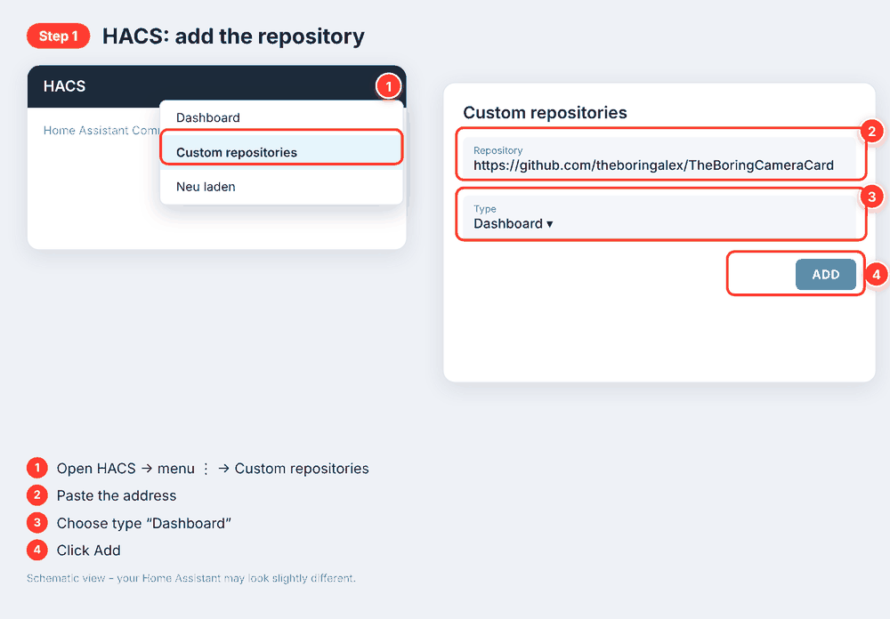
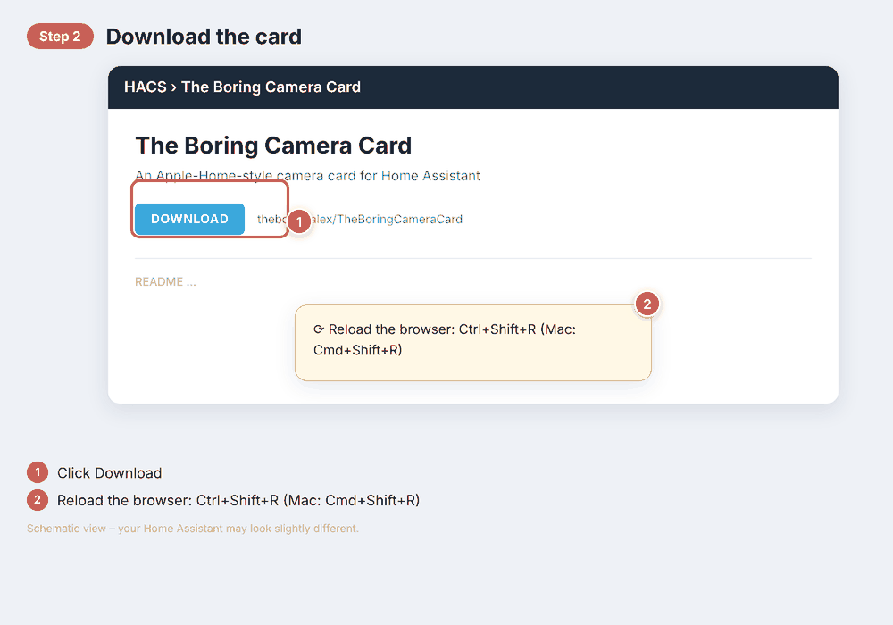
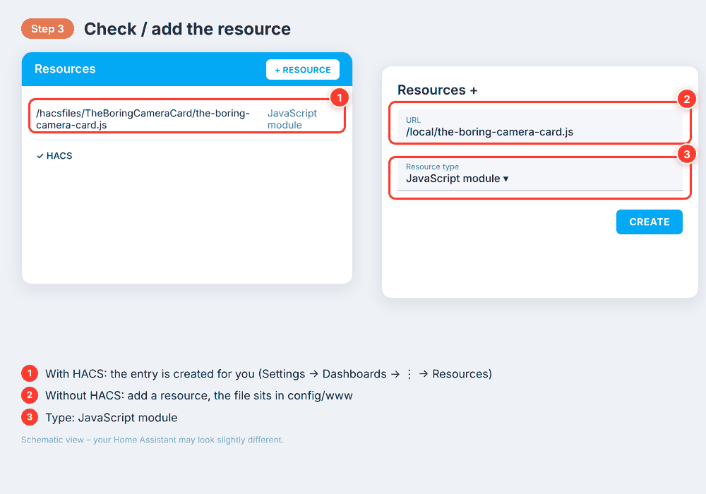
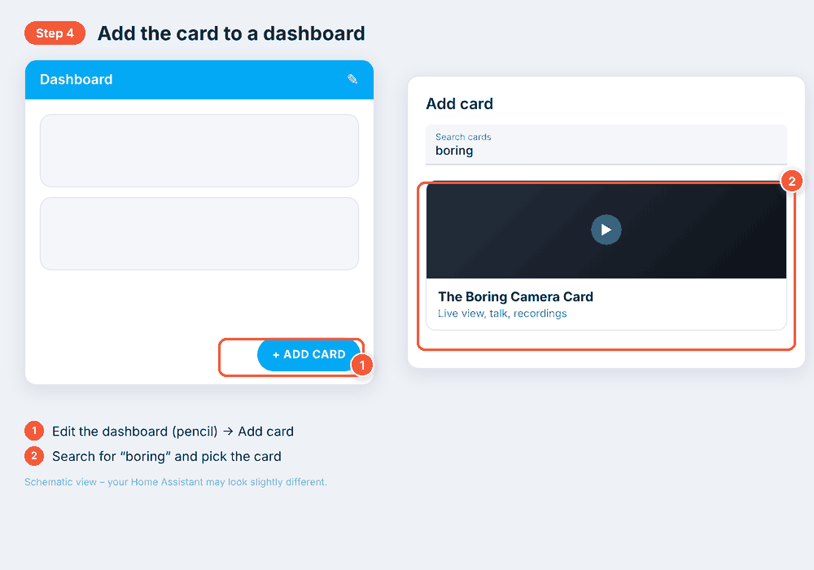
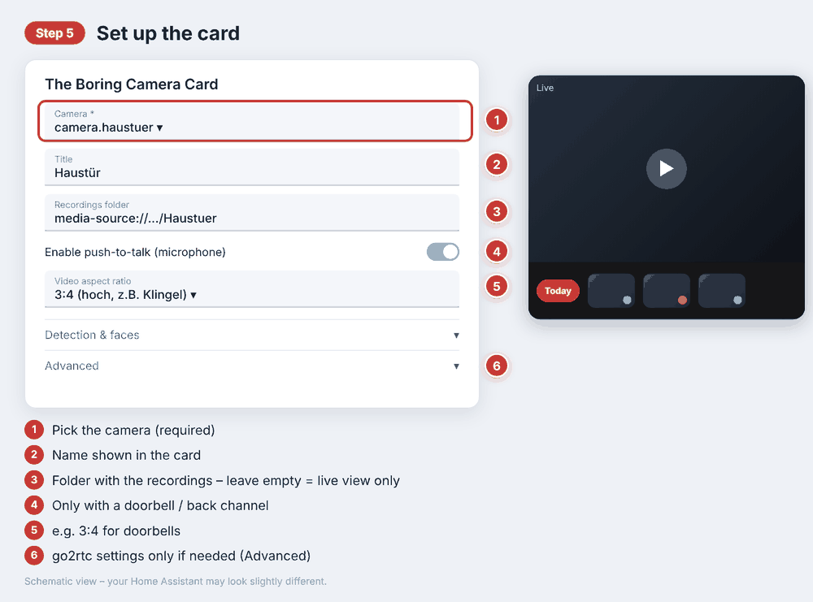

# The Boring Camera Card

*[Deutsche Version](README.de.md)*

A camera card for your Home Assistant dashboard that looks and feels like the
camera view in Apple Home: smooth live video, a button to talk through the
camera's speaker, and a strip of past recordings you can scroll through and
tap to play.

## Download

| | |
|---|---|
| **HACS (recommended)** | [Add this repository to HACS](https://my.home-assistant.io/redirect/hacs_repository/?owner=theboringalex&repository=TheBoringCameraCard&category=plugin) |
| **Manual download** | [the-boring-camera-card.js](https://github.com/theboringalex/TheBoringCameraCard/raw/main/the-boring-camera-card.js) · [Repository as ZIP](https://github.com/theboringalex/TheBoringCameraCard/archive/refs/heads/main.zip) |
| **Support the project** | [Buy me a coffee](https://www.buymeacoffee.com/theboringalex) |

## What it does

- Live view of your camera through [go2rtc](https://github.com/AlexxIT/go2rtc), which Home Assistant already includes — fast, at home and away
- Push-to-talk, if your camera can play sound back (most video doorbells can)
- A row of thumbnails of past recordings with a fixed "Today" button; press and hold to download or delete
- Person / animal / vehicle markers on the thumbnails (Reolink AI detection) and round face avatars (e.g. from TheBoringFace)
- A lower-quality stream in the normal view to save data, full quality in fullscreen
- Auto live stream: starts by itself when the card becomes visible, stops when it is hidden
- Shapes to fit your camera: 16:9, 4:3, 1:1, or tall 3:4 for doorbells

## Setup guide

No YAML needed — everything is set up through forms. *(The pictures are schematic; your Home Assistant may look slightly different.)*

### 1. Add the repository to HACS

Open HACS → menu (⋮) → **Custom repositories**, paste `https://github.com/theboringalex/TheBoringCameraCard`, choose type **Dashboard**, click **Add**.

### 2. Download the card

Open *The Boring Camera Card* in HACS, click **Download**, then reload your browser (Ctrl+Shift+R, Mac: Cmd+Shift+R).

### 3. Check the dashboard resource

HACS normally adds it for you. If the card is not found later, add it by hand: **Settings → Dashboards → ⋮ → Resources → Add resource**, URL `/hacsfiles/TheBoringCameraCard/the-boring-camera-card.js`, type **JavaScript module**.

### 4. Add the card to a dashboard

Edit your dashboard (pencil) → **Add card** → search for "boring" → *The Boring Camera Card*.

### 5. Fill in the card's form

Pick your camera, optionally the recordings folder, and switch on push-to-talk if your camera has a speaker. The rest is optional.

### By hand (without HACS)

Copy `the-boring-camera-card.js` to `config/www/`, then add the resource `/local/the-boring-camera-card.js` (type *JavaScript module*) as in step 3 and continue with step 4.

## Advanced settings

The card's **Advanced** section holds options most people never need:

| Option | When you'd need it |
|---|---|
| `go2rtc_url` | Name of the go2rtc stream, if it differs from the camera entity |
| `go2rtc_url_sub` | A second, lower-quality stream for the normal view |
| `go2rtc_server_lan` | go2rtc runs on a *different* device than Home Assistant, e.g. `http://192.168.1.50:1984` |
| `go2rtc_ingress` | Remote access through Home Assistant's own proxy (go2rtc add-on) |
| `go2rtc_server` | A separate web address for go2rtc when you are away from home |
| `go2rtc_token` | Your own reverse proxy in front of go2rtc requires one |
| `bitrate_entity` | Optional sensor shown as bitrate |
| `debug` | Extra diagnostics in the browser console |

## Detections & faces

- **Person / animal / vehicle:** if your camera has AI detection (e.g. Reolink), a coloured
  dot appears at the bottom right of each thumbnail: blue = person, orange = animal,
  purple = vehicle. The sensors are found automatically from the camera's device.
- **Faces:** images next to a recording named `<recording>__face__<Name>.jpg` (e.g. from
  TheBoringFace) are shown as a round avatar at the top right.

## A couple of things to know

- **Push-to-talk needs a secure connection (HTTPS), or "localhost".** Browsers only allow
  microphone access on secure connections — a browser rule, not something this card can work
  around. Over plain `http://` the button simply won't respond.
- Connections through Home Assistant's built-in proxy (ingress) can occasionally drop — a known
  Home Assistant quirk. A dedicated reverse proxy in front of go2rtc tends to be more reliable
  for access from outside your home.

## Support this project

If this card made your dashboard nicer, you can [buy me a coffee](https://www.buymeacoffee.com/theboringalex) — totally optional,
and always appreciated.

## Found a problem, or have an idea?

This is a small side project built in my spare time — [issues](https://github.com/theboringalex/TheBoringCameraCard/issues)
and pull requests are welcome, just please be patient waiting for a reply.

## License

MIT — see [LICENSE](LICENSE).
